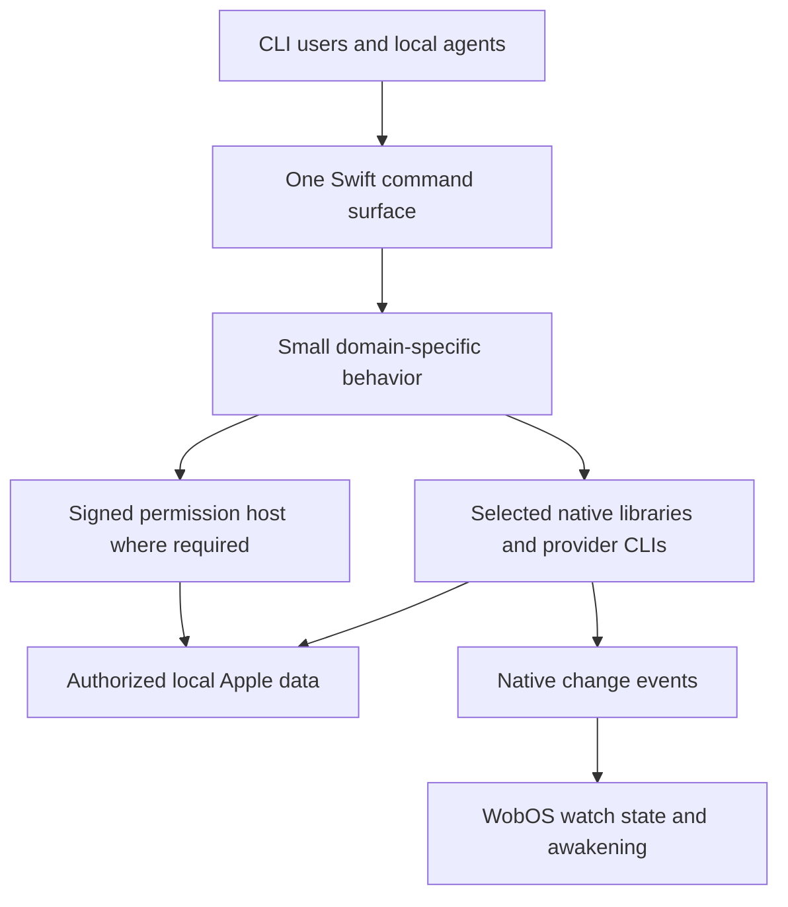

# GrannySwift: initial design capture

**Status:** Owner decisions captured; detailed design and implementation remain open.  
**Capture:** November 4, 2026, local conversation date (America/New_York).  
**Destination:** the public `justanothernon-dev/GrannySwift` repository.

This is the organized starting braindump for the rebuild, not a final specification or installation report. It records what was selected, why it matters, what changed during the discussion, and what a fresh coding agent should investigate next. The owner asked to put this record in a PR first and continue `/grill-with-docs` from the repository afterward.

The current package is a scaffold with a placeholder executable. The selected libraries below are not all installed. No platform capability is considered working solely because its upstream project advertises it.

## 1. What we are building

A simple, Swift-first macOS capability layer with useful command outputs for people and local agents. The public project should make sense without the owner's private setup or WobOS. WobOS is a consumer, not the product's required runtime.

The former AppleSuite implementation is a source of useful behavior and lessons. It is not a module layout, output schema, or Python architecture to reproduce automatically.

The central owner direction was:

> "principles are primarily swift first, overhauling previous python architectural glues...simple architectures, with straightforward cli extensbility as needed for certain things underlying libraries we'll have might use, that the clis do not."

Another important constraint:

> "useful outputs rather than raw capabilities, efficiency is key, and bear in mind im learning swift as we go about building this."

Those choices favor a small amount of understandable product code around proven native implementations. Efficiency includes latency, process startup, repeated reads, model work, output size, and maintenance effort. It does not justify dropping original content or concealing uncertainty.

## 2. Locked architectural choices

| Decision | Meaning |
| --- | --- |
| One primary Swift executable, with compatibility aliases | One coherent product entry point. Final naming, command hierarchy, flags, schemas, and alias behavior still need design. |
| Swift-first project-owned integration | Replace custom Python routing and adaptation. Keep upstream Python or TypeScript engines where they solve a real problem. |
| Extend before rebuilding | Inspect the underlying library. Prefer a small natural CLI/library extension to a second implementation. |
| Beeper CLI route | Extend Beeper's existing CLI selectively; do not start by writing a new direct-SDK Messages engine. Other libraries may be linked directly when that is the simplest useful route. |
| One primary engine per ordinary operation | Avoid duplicate identity/history reads and silent cross-vendor fallbacks. An exception must earn its place with a specific capability. |
| Coherent signing and permission ownership | Use stable identities and a permission-owning host where required. A shared certificate is not a blanket privacy grant. |
| Useful, truthful outputs | Compact where helpful, complete where requested, with meaningful identity, coverage, continuation, and verified outcomes. |
| Public and understandable | Portable instructions, sanitized fixtures, appropriate licensing and release practices, and code explanations that support learning Swift. |
| WobOS owns agent orchestration | GrannySwift supplies operations and factual events; WobOS owns watch state, cases, decisions, notifications, and recovery checkpoints. |
| Avoid speculative infrastructure | No general plugin framework, extra scheduler, persistent data store, daemon, or dependency container without a demonstrated requirement. |

A small permission host and a persistent native Messages session can be justified components. They are not permission to build a second orchestration system.

This is a responsibility map, not a finalized process topology. It does not claim that every provider can share one permission grant or run inside one process.

## 3. Provider and capability decisions

| Domain | Selected direction | Boundary |
| --- | --- | --- |
| Messages | [Beeper](https://github.com/beeper/platform-imessage) | Primary reads, search, supported actions, media, and events; expose useful library capabilities through minimal CLI additions. |
| Send Later | Narrow Swift reader informed by [imsg](https://github.com/openclaw/imsg) | Read scheduled-message records early. No second imsg engine and no scheduling writes implied. |
| Calendar and Contacts | [Apple PIM](https://github.com/omarshahine/apple-pim) | Reuse the native Swift implementations and preserve valuable existing behavior. |
| Reminders | [RemCTL](https://github.com/viticci/remctl) | Keep its richer Reminders capabilities rather than reducing scope to EventKit-only operations. |
| Notes | [Apple Notes MCP](https://github.com/sweetrb/apple-notes-mcp) | Keep separate; no new wrapper for now. |
| Photos | [osxphotos](https://github.com/RhetTbull/osxphotos) | Direct existing interface or alias, not a new Photos implementation. |
| Voice Memos | [TSRP](https://github.com/mattt/TSRP) plus a small export/extraction capability | One library for discovery and local-file resolution; extend around it rather than add another exporter runtime. |
| Call history | Relevant [iMCP Phone](https://github.com/mattt/iMCP/blob/main/App/Services/Phone.swift) implementation patterns | Read-only locally available missed/incoming/outgoing history, with meaningful scope. |
| Visual voicemail | Relevant [iMCP voicemail](https://github.com/mattt/iMCP/blob/main/App/Services/VoicemailStore.swift) implementation patterns | Read-only metadata and available audio; no deletion or read-state mutation in the initial scope. |
| Transcription | [FluidAudio](https://github.com/FluidInference/FluidAudio) and the selected Parakeet Ultra model family | Our recognition pipeline by default; preserve the existing useful transcription contract and consumers. |
| Mail | Gmail | Local Apple Mail is out of scope. |

### Messages and awakening

The selected route is Beeper for normal reads and supported actions, not Beeper listing followed by imsg identity and history reconstruction. Candidate CLI extensions include scoped/paged search, useful asset access, and a clean machine-readable event stream. Inspect what the selected revision already exposes before implementing a gap.

Preserve the valuable behavior: unambiguous conversation and message-part identities, full sender turns, original message content, group speakers, reactions, local media availability, bounded history, pagination, and honest partial results. Reaction activity must not silently become the last actual speaker. A manually flagged unread conversation must not disappear under a reaction-only exclusion.

The earlier AppleSuite discussion used the latest 15 unread conversations plus additional five-day activity and two complete sender turns as its concrete inbox baseline. Keep that as migration context, not an excuse to hard-code every old flag or prevent the forthcoming CLI/output design. Historical sample timings are not a full-inbox acceptance result.

Reads should not silently change badges or read state. For writes, resolve the exact target, execute within authority, and verify the intended outcome. A native success response does not by itself prove a correct reply association, delivery, or recipient attention. Preserve uncertainty rather than automatically repeating a possibly successful send.

Watched-conversation awakening belongs in v1 after read parity. Use one Beeper watcher and an appropriate event handoff, not a watcher per chat or a parallel imsg watcher. WobOS owns subscriptions, expiry, conditions, checkpoints, deduplication, and notifications. Recovery after sleep/restart must be exercised using history reconciliation; a live event stream is not a durable replay guarantee. Swift Async Algorithms can help combine or batch notifications, but must not discard source messages through an ill-chosen debounce.

Send Later is a narrow read of locally stored scheduled-message records. Status interpretation and coverage must be validated. Listing a future row does not create, reschedule, cancel, or guarantee delivery of a scheduled message.

### Voice Memos and transcription

The final correction was to use TSRP and add extraction, not keep two Voice Memos readers. TSRP already resolves locally available recording files. Build the small missing behavior around those results: unambiguous selection, safe copying/staging, original-format preservation, collision handling, and truthful receipts.

Use [macos-voice-memos-export](https://github.com/polarity-dev/macos-voice-memos-export) as reference material for restricted broker operations and export safety, not a selected runtime dependency. Do not copy its separate application topology or ad-hoc signing automatically.

Keep source audio unchanged. Distinguish an original-format file copy from decoding, conversion, or a rendered version of edits. Verify actual `.m4a` and `.qta` recordings and edited-recording behavior before promising exported fidelity. A metadata record may have no usable local audio; do not claim an iCloud-only item was exported.

FluidAudio is selected, not merely a comparison candidate. Generally run our own recognition rather than treating Apple's existing transcripts as preferred output. Native transcripts can be explicitly labeled supplementary data; they must not silently substitute for a requested FluidAudio result.

Preserve the useful existing transcription behavior: complete inline results when requested, raw recognition distinct from cleanup, word/segment times, optional anonymous speaker labels and overlap uncertainty, ordered batch outcomes, JSON/TXT/SRT/VTT exports, compact export receipts, partial-success reporting, offline ordinary execution, explicit model preparation, and cancellation.

The existing Toolington transcription command is a migration and consumer-compatibility reference, not a reason to freeze final feature naming or packaging now. Do not create a second recognition engine or assume existing MLX artifacts load directly into Core ML. Preserve the selected model family through a compatible prepared artifact and verify long-form completeness, decoding, speaker attribution, and actual end-to-end performance.

### Calls, voicemail, Notes, and Photos

Calls and voicemail are read-only scope additions. Local availability, sync coverage, supported schemas, audio formats, and permissions must be explicit. The iMCP implementations are source references, not evidence of a tested GrannySwift feature.

Notes MCP stays separately accessible. Photos stays with osxphotos. Neither needs a speculative facade to make a diagram appear uniform. Do not duplicate those engines merely to eliminate every non-Swift dependency.

## 4. Signing, permissions, and local communication

The owner wants a coherent project-wide signing and access story. Design toward a stable signed host for protected operations where needed, while preserving provider-specific permission ownership when consolidation cannot be demonstrated.

Learn selectively from iMCP, Apple PIM, and the Voice Memos exporter: scoped folder grants, explicit authorization, restricted local requests, safe staging, and cleanup. A folder grant may need to cover the database, its write-ahead log, and companion assets. Do not silently ignore a live WAL and then describe the result as complete or current.

The communication mechanism is not chosen yet. Do not introduce an MCP server, HTTP listener, Bonjour discovery, or a generic RPC framework merely because a reference uses one. Select the smallest adequate mechanism after establishing the process boundary and caller-trust requirement.

The host must expose bounded operations, not arbitrary protected paths or shell execution. Signing, caller verification, and user privacy permission are separate facts. Restrict subprocess environments and redact credentials before diagnostics reach logs. Code-signing material stays outside source control. Release signing/notarization, helper identities, required entitlements, authorization continuity, and supported platforms are implementation gates, not completed setup.

## 5. Selected libraries and developer tools

Selection means use the established solution where its job exists. It does not mean install every package now or invent a feature for it.

| Selection | Intended job |
| --- | --- |
| [Swift Argument Parser](https://github.com/apple/swift-argument-parser) | Commands, arguments, validation, and help. |
| [Swift Subprocess](https://github.com/swiftlang/swift-subprocess) | External provider execution, I/O, cancellation, and exit handling. |
| [SwiftyJSON](https://github.com/SwiftyJSON/SwiftyJSON) | Less boilerplate for dynamic vendor JSON. Validate required identifiers instead of accepting empty defaults. |
| Foundation Codable | Typed contracts GrannySwift controls. |
| [SQLite.swift](https://github.com/stephencelis/SQLite.swift) | Narrow read-only native database access, beginning with Send Later. No new owned database is implied. |
| [PhoneNumberKit](https://github.com/marmelroy/PhoneNumberKit) | Phone normalization across Messages, Contacts, and calls. Normalization alone does not prove identity. |
| [Swift Markdown](https://github.com/swiftlang/swift-markdown) | Structured document processing where needed. |
| [Swift Testing](https://github.com/swiftlang/swift-testing) and [Quick](https://github.com/Quick/Quick) | Ordinary checks and useful behavior-driven specifications without duplicate suites. |
| [Swift Async Algorithms](https://github.com/apple/swift-async-algorithms) | Event coordination when implementing the watcher; not durable storage or replay. |
| [SwiftFormat](https://github.com/nicklockwood/SwiftFormat) and [SwiftLint](https://github.com/realm/SwiftLint) | One authoritative formatter and complementary quality rules. |
| [Jazzy](https://github.com/realm/jazzy) | Generated documentation when the public API stabilizes. |
| [FluidAudio](https://github.com/FluidInference/FluidAudio) | Selected speech engine; shared transcription behavior, not another orchestration layer. |
| Swift Package Manager | Project dependency/build foundation. |

KeychainAccess or Valet remains a potential choice if the product owns secrets. Inject is relevant to development of a real native UI; Cache to measured, safely cacheable work. Swinject, Needle, GRDB, AudioKit, and direct SwiftSyntax usage remain optional candidates, not automatic additions. SourceKit-LSP supports code intelligence. DocC and the official `swift-format` were researched alternatives, not reasons to run competing documentation/formatting systems.

## 6. Outputs and development quality

Useful output is part of the product design. Machine-readable stdout must stay separate from diagnostics. Keep source IDs, time semantics, pagination, data availability, and partial failures usable without flooding the caller with raw vendor payloads. Explicit exports need real file receipts and must retain earlier successes after a later failure. Event framing should be machine-readable; final schemas and naming are deferred to design.

Carry forward the useful lessons from the earlier rebuild: one current source for each decision; component documentation distinct from install receipts; explanations close to non-obvious code; small reversible agent choices labeled as such; real application verification at meaningful milestones; and temporary handoffs that reference durable records rather than duplicating them. Do not import that project's language, orchestration framework, private instructions, or blanket SDK-first policy over GrannySwift's explicit choices.

Keep a practical root README, concise agent instructions, focused folder-level conceptual READMEs for meaningful implemented components, sanitized fixtures, and source attribution. The owner will shape the tone and explanatory framing of those component walkthroughs; coding agents should use source knowledge to maintain their accuracy in that voice, without imposing a rigid documentation template. Contributor policy is not a priority for the kickoff. Use established Swift constructs and flag relevant standard resources while explaining decisions to a learner. Preserve license notices when adapting code. Public usability must not require private paths, accounts, skill installations, or repository access.

## 7. Choices explicitly superseded

| Earlier idea | Current direction |
| --- | --- |
| Continue ordinary Beeper + imsg hybrid history | Beeper primary route; imsg is only a source reference for Send Later. |
| Keep imsg watching alongside Beeper | One Beeper event route plus consumer-owned recovery. |
| Add icloud-md | Excluded; retain Notes MCP. |
| Install the separate Voice Memos exporter | TSRP plus a small extraction/export addition; exporter code is reference material. |
| Prefer Apple's existing transcript before our ASR | FluidAudio generally supplies our own transcripts. |
| Rewrite every upstream provider into Swift | Swift-first project-owned glue; keep capable upstream engines. |
| Freeze command names and directory layout now | Design them deliberately in the next phase. |
| Treat all assistant recommendations as locked | Only explicit owner choices are settled; unresolved recommendations live in GRILL.md. |

## 8. Implementation gates and next step

The remaining evidence gates are: permission ownership and caller boundaries; full Beeper inbox and targeted-action parity; watcher mapping/recovery; Send Later state interpretation; TSRP extraction and format fidelity; locally synced call/voicemail availability; FluidAudio accuracy/diarization/consumer compatibility; and supported toolchain, packaging, licenses, signing, and releases.

These are not reasons to restart library selection. They are the things implementation must demonstrate. Earlier source reviews and selected-conversation experiments do not prove a new installed integration, full inbox latency, or production durability.

The next action is the repository-grounded design session in [GRILL.md](GRILL.md). Refine the interfaces and scope, then write an approved slice specification and proceed in small, verifiable increments. This documentation PR does not install dependencies, alter permissions, implement providers, or authorize a full migration.
